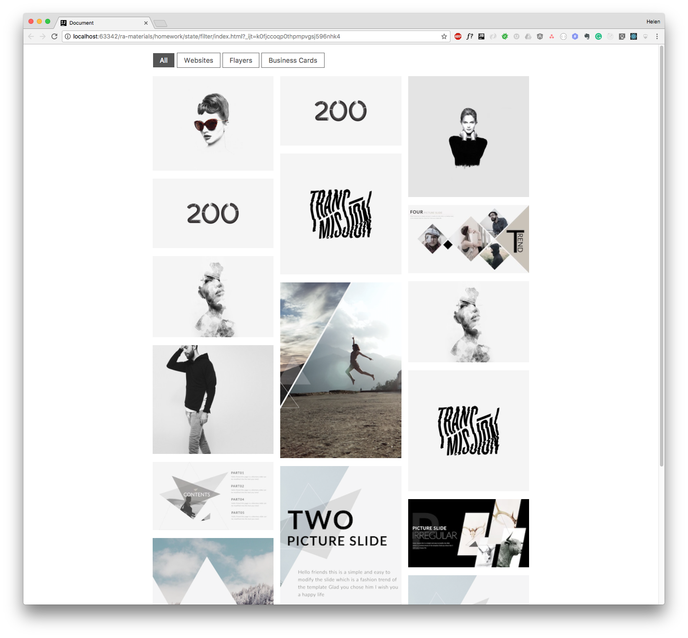

Портфолио с фильтрами
===

Веб-приложение для отображения портфолио проектов с фильтрацией по категориям.
Проект собран на [Vite](https://vite.dev/) (шаблон `react`), ESLint настроен по умолчанию.



## Структура проекта

```
ra_events_state_filter/
├── assets/                  # скриншоты для README
├── public/
│   └── img/                 # изображения проектов 
├── src/
│   ├── main.jsx             # точка входа
│   ├── App.jsx
│   ├── App.css              # все стили проекта
│   └── components/
│       ├── Portfolio.jsx    # классовый компонент с состоянием
│       ├── Toolbar.jsx      # stateless: панель фильтров
│       └── ProjectList.jsx  # stateless: список карточек
├── index.html
├── eslint.config.js
├── vite.config.js
├── package.json
└── README.md
```

## Архитектура

| Компонент | Состояние | Ответственность |
|---|---|---|
| `Portfolio` | class, state | хранит активный фильтр, вычисляет уникальные категории, фильтрует список |
| `Toolbar` | stateless | отображает кнопки фильтров, выделяет активную, вызывает `onSelectFilter` |
| `ProjectList` | stateless | отображает карточки проектов, `key` — стабильный `id`, не индекс |

Данные движутся вниз через пропсы (`filters`, `selected`, `projects`), событие пользователя — вверх через callback `onSelectFilter`.

## Запуск

```bash
yarn        # или npm install
yarn dev    # или npm run dev
```

Приложение откроется на http://localhost:5173.

Линтер:

```bash
yarn lint   # или npm run lint
```

## Изображения

Картинки проектов лежат локально в `public/img/`

## Проверка

- По умолчанию выбран фильтр «All», видны все 17 карточек.
- Клик по категории показывает только её проекты.
- Активный фильтр подсвечен синим.
- Названия фильтров вычисляются из данных (уникальные категории), а не дублируются вручную.